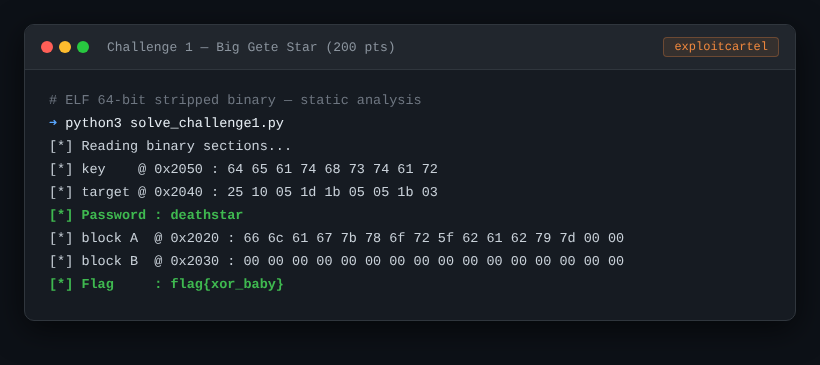

# Challenge 1 — Big Gete Star (200 pts)

> **Category:** Reverse Engineering  
> **Points:** 200  
> **Flag:** `flag{xor_baby}`

---

## Overview

A stripped 64-bit ELF Linux binary with a password check and a hidden XOR-encoded flag in the `.data` section.

```
File: challenge1
Type: ELF 64-bit LSB pie executable, x86-64, stripped
```

---

## Static Analysis

### Step 1 — File Identification

```bash
$ file challenge1
challenge1: ELF 64-bit LSB pie executable, x86-64, version 1 (SYSV),
dynamically linked, interpreter /lib64/ld-linux-x86-64.so.2, stripped
```

### Step 2 — Strings

Running `strings` reveals nothing useful — the binary is stripped and the flag is XOR-encoded in `.data`.

### Step 3 — Disassembly (`.data` section layout)

Using a hex editor / Python to map `.data`:

| Offset | Size | Purpose |
|--------|------|---------|
| `0x2020` | 16 bytes | XOR operand A (flag part 1) |
| `0x2030` | 16 bytes | XOR operand B (flag part 2) |
| `0x2040` | 9 bytes  | XOR target (password check) |
| `0x2050` | 9 bytes  | XOR key for password |

The binary checks the password by XOR-ing user input against a 9-byte key and comparing to 9 known bytes.

**Password recovery:**
```
key     @ 0x2050: bytes from binary
target  @ 0x2040: bytes from binary
password = key XOR target = "deathstar"
```

### Step 4 — Flag Extraction

The actual flag is stored as two 16-byte blocks that are XOR'd together at runtime:

```
block A @ 0x2020
block B @ 0x2030
flag    = A XOR B
```

---

## Solve Script

```python
#!/usr/bin/env python3
# solve_challenge1.py

data = open('challenge1', 'rb').read()

# Password check (bonus)
key    = data[0x2050:0x2059]
target = data[0x2040:0x2049]
passwd = bytes([a ^ b for a, b in zip(key, target)])
print(f"[*] Password : {passwd.decode()}")

# Flag extraction
b1   = data[0x2020:0x2030]
b2   = data[0x2030:0x2040]
flag = bytes([a ^ b for a, b in zip(b1, b2)])
print(f"[*] Flag     : {flag.decode()}")
```

### Output

```
[*] Password : deathstar
[*] Flag     : flag{xor_baby}
```

---

## Key Takeaways

- The binary uses XOR as both a password check and flag storage mechanism
- Stripping symbols doesn't hide data-section XOR patterns — offsets are still readable
- **Known-plaintext** (`flag{`) can confirm the XOR key even without running the binary

---

## Solve Screenshot



## Flag

```
flag{xor_baby}
```
