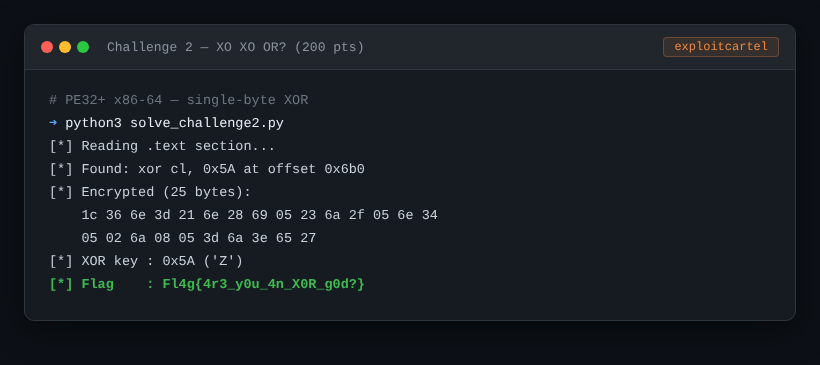

# Challenge 2 — XO XO OR? (200 pts)

> **Category:** Reverse Engineering  
> **Points:** 200  
> **Flag:** `Fl4g{4r3_y0u_4n_X0R_g0d?}`

---

## Overview

A PE32+ Windows x86-64 console executable with the flag XOR-encrypted inline in the `.text` section. The key is embedded as an immediate in a `xor cl, 0x5a` instruction.

```
File: challenge_2.exe
Type: PE32+ executable (console) x86-64, MS Windows
```

---

## Static Analysis

### Step 1 — File Identification

```bash
$ file challenge_2.exe
challenge_2.exe: PE32+ executable (console) x86-64, MS Windows
```

### Step 2 — Locating the Encrypted Flag

Scanning the `.text` section for the XOR instruction pattern:

```
offset 0x680:  encrypted flag bytes (25 bytes)
...
offset 0x6b0:  xor cl, 0x5a        ; key = 0x5a = 'Z'
```

**Encrypted bytes (hex):**
```
1c 36 6e 3d 21 6e 28 69 05 23 6a 2f 05 6e 34 05
02 6a 08 05 3d 6a 3e 65 27
```

### Step 3 — Key Identification

The disassembly shows:

```asm
; Inner decrypt loop
xor    cl, 0x5a          ; single-byte XOR key = 0x5A ('Z')
mov    [rbp+rax], cl
inc    rax
cmp    rax, 0x19         ; loop 25 times (0x19 = 25)
jl     loop_top
```

Key: `0x5A` ('Z')

---

## Solve Script

```python
#!/usr/bin/env python3
# solve_challenge2.py

enc = bytes([
    0x1c, 0x36, 0x6e, 0x3d, 0x21, 0x6e, 0x28, 0x69,
    0x05, 0x23, 0x6a, 0x2f, 0x05, 0x6e, 0x34, 0x05,
    0x02, 0x6a, 0x08, 0x05, 0x3d, 0x6a, 0x3e, 0x65, 0x27
])

KEY = 0x5A  # 'Z'

flag = bytes([b ^ KEY for b in enc])
print(f"[*] XOR key : 0x{KEY:02X} ('{chr(KEY)}')")
print(f"[*] Flag    : {flag.decode()}")
```

### Output

```
[*] XOR key : 0x5A ('Z')
[*] Flag    : Fl4g{4r3_y0u_4n_X0R_g0d?}
```

---

## Disassembly Snippet

```asm
; challenge_2.exe — flag decryption loop (pseudo)
lea    rax, [rip+enc_flag]   ; pointer to 25 encrypted bytes
xor    ecx, ecx              ; counter = 0
loop_top:
  mov    cl, byte [rax+rcx]
  xor    cl, 0x5A            ; KEY
  mov    byte [rax+rcx], cl  ; decrypt in place
  inc    ecx
  cmp    ecx, 0x19
  jl     loop_top
; flag now plaintext in buffer
```

---

## Key Takeaways

- Single-byte XOR with a hardcoded immediate is trivially reversible via static analysis
- No anti-debug or obfuscation — pure beginner-level crypto challenge
- The key `0x5A` ('Z') is visible directly in the disassembly as `xor cl, 0x5a`

---

## Solve Screenshot



## Flag

```
Fl4g{4r3_y0u_4n_X0R_g0d?}
```
