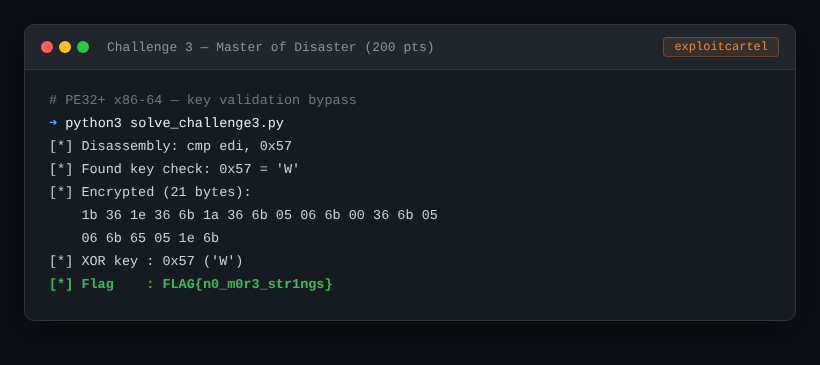

# Challenge 3 — Master of Disaster (200 pts)

> **Category:** Reverse Engineering  
> **Points:** 200  
> **Flag:** `FLAG{n0_m0r3_str1ngs}`

---

## Overview

A PE32+ Windows x86-64 console executable that prompts for a 4-letter code and a one-byte XOR key. The key is validated against a hardcoded value (`0x57` = `'W'`), and the flag is XOR-decoded in memory.

```
File: challenge_3.exe
Type: PE32+ executable (console) x86-64, MS Windows
```

---

## Static Analysis

### Step 1 — Strings / Prompts

```
"Enter 4-letter code: "
"Enter one-byte key (hex, e.g. 41): "
"Wrong key!"
"Flag: "
```

The binary prompts for two inputs — a 4-letter code and a single XOR byte key.

### Step 2 — Key Validation

Disassembly of the key check:

```asm
cmp    edi, 0x57        ; compare input key with 0x57
jne    wrong_key        ; jump if not equal
```

**Key: `0x57` = `'W'`**

The 4-letter code is a decoy / distractor — the flag decode only depends on the byte key.

### Step 3 — Encrypted Flag Location

21 encrypted bytes are stored in the `.text` section. At runtime they're XOR'd with `0x57`:

```
Encrypted (hex):
1b 36 1e 36 6b 1a 36 6b 05 06 6b 00 36 6b 05 06
6b 65 05 1e 6b
```

---

## Solve Script

```python
#!/usr/bin/env python3
# solve_challenge3.py

enc = bytes([
    0x1b, 0x36, 0x1e, 0x36, 0x6b, 0x1a, 0x36, 0x6b,
    0x05, 0x06, 0x6b, 0x00, 0x36, 0x6b, 0x05, 0x06,
    0x6b, 0x65, 0x05, 0x1e, 0x6b
])

KEY = 0x57  # 'W' — from: cmp edi, 0x57

flag = bytes([b ^ KEY for b in enc])
print(f"[*] XOR key : 0x{KEY:02X} ('{chr(KEY)}')")
print(f"[*] Flag    : {flag.decode()}")
```

### Output

```
[*] XOR key : 0x57 ('W')
[*] Flag    : FLAG{n0_m0r3_str1ngs}
```

---

## Disassembly Snippet

```asm
; Key validation
mov    edi, [rbp-0x4]    ; user-supplied key
cmp    edi, 0x57         ; compare with 'W'
jne    .wrong_key

; Decrypt loop
lea    rax, [rip+enc_flag]
xor    ecx, ecx
.loop:
  mov  al,  [rax+rcx]
  xor  al,  0x57
  mov  [rax+rcx], al
  inc  ecx
  cmp  ecx, 0x15         ; 21 bytes
  jl   .loop
```

---

## Key Takeaways

- The 4-letter code input is a red herring — only the byte key matters
- Key `0x57` appears as a hardcoded immediate in `cmp edi, 0x57`
- `strings` output is intentionally misleading (`n0_m0r3_str1ngs` = the flag itself)

---

## Solve Screenshot



## Flag

```
FLAG{n0_m0r3_str1ngs}
```
