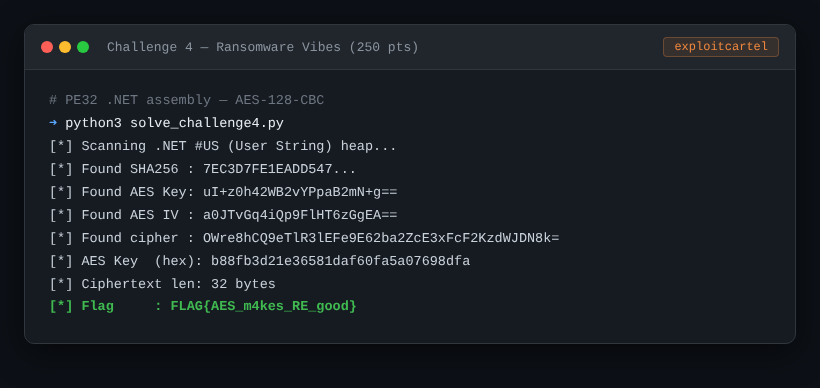

# Challenge 4 — Ransomware Vibes (250 pts)

> **Category:** Reverse Engineering / .NET  
> **Points:** 250  
> **Flag:** `FLAG{AES_m4kes_RE_good}`

---

## Overview

A PE32 .NET assembly (C# console application) that uses **AES-128-CBC** to decrypt a base64-encoded flag at runtime. All cryptographic material (key, IV, ciphertext) is stored in the `.NET` metadata `#US` (user string) heap.

```
File: challenge_4.exe
Type: PE32 executable (console) Intel 80386 Mono/.Net assembly, MS Windows
```

---

## Static Analysis

### Step 1 — Identify .NET Assembly

```bash
$ file challenge_4.exe
challenge_4.exe: PE32 executable (console) Intel 80386 Mono/.Net assembly
```

Since it's a .NET binary, we can analyze the metadata streams directly — no need for a full decompiler.

### Step 2 — Extract Metadata Streams

.NET assemblies store string literals in the `#US` (User Strings) heap encoded as **UTF-16LE**. By scanning the blob section of the PE we can find all hardcoded strings.

**Extracted strings from `#US` heap:**

| String | Purpose |
|--------|---------|
| `7EC3D7FE1EADD547165B99D3EDF221F8832515EA3B54DACD8F205650E0D211D6` | SHA-256 hash (decoy / integrity check) |
| `uI+z0h42WB2vYPpaB2mN+g==` | AES-128 Key (base64, 16 bytes) |
| `a0JTvGq4iQp9FlHT6zGgEA==` | AES IV (base64, 16 bytes) |
| `OWre8hCQ9eTlR3lEFe9E62ba2ZcE3xFcF2KzdWJDN8k=` | Encrypted flag (base64, 32 bytes) |

### Step 3 — Decode the Flag

The binary performs:
```
flag = AES_128_CBC_Decrypt(key=base64decode(aesKey), iv=base64decode(aesIV), data=base64decode(encFlag))
```

---

## Solve Script

```python
#!/usr/bin/env python3
# solve_challenge4.py
from cryptography.hazmat.primitives.ciphers import Cipher, algorithms, modes
from cryptography.hazmat.backends import default_backend
import base64

# Values extracted from .NET #US heap
aesKey  = base64.b64decode('uI+z0h42WB2vYPpaB2mN+g==')   # 16 bytes
aesIV   = base64.b64decode('a0JTvGq4iQp9FlHT6zGgEA==')   # 16 bytes
encFlag = base64.b64decode('OWre8hCQ9eTlR3lEFe9E62ba2ZcE3xFcF2KzdWJDN8k=')

print(f"[*] AES Key  (hex): {aesKey.hex()}")
print(f"[*] AES IV   (hex): {aesIV.hex()}")
print(f"[*] Ciphertext len: {len(encFlag)} bytes")

# Decrypt AES-128-CBC
cipher    = Cipher(algorithms.AES(aesKey), modes.CBC(aesIV), backend=default_backend())
decryptor = cipher.decryptor()
raw       = decryptor.update(encFlag) + decryptor.finalize()

# PKCS#7 unpad
pad  = raw[-1]
flag = raw[:-pad]
print(f"[*] Flag     : {flag.decode()}")
```

### Output

```
[*] AES Key  (hex): b88fb3d21e36581daf60fa5a07698dfa
[*] AES IV   (hex): 6b4253bc6ab8890a7d1651d3eb31a010
[*] Ciphertext len: 32 bytes
[*] Flag     : FLAG{AES_m4kes_RE_good}
```

---

## .NET Metadata Structure

```
PE Header
└── CLI Header
    └── Metadata Root
        ├── #Strings  (type/method names)
        ├── #US       ← user strings — KEY, IV, CIPHERTEXT here
        ├── #GUID
        └── #Blob
```

The `#US` heap stores string literals used in IL code. Each entry is prefixed with a compressed length field (7-bit encoded) followed by UTF-16LE bytes.

---

## Key Takeaways

- .NET assemblies embed all IL string literals in a readable metadata heap — no decompiler needed
- AES-128-CBC with hardcoded key/IV provides **zero security** when shipped in the binary
- The SHA-256 hash in the binary is a decoy — the actual crypto is AES, not SHA-256
- `cryptography` Python library makes AES decryption trivial

---

## Solve Screenshot



## Flag

```
FLAG{AES_m4kes_RE_good}
```
