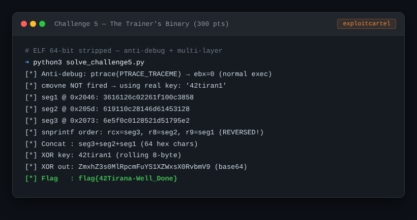

# Challenge 5 — The Trainer's Binary (300 pts)

> **Category:** Reverse Engineering (Hard)  
> **Points:** 300  
> **Flag:** `flag{42Tirana-Well_Done}`

---

## Overview

A stripped 64-bit ELF Linux binary with **multiple layers of obfuscation**:
- Anti-debug via `ptrace`
- Three hex-encoded segments in `.rodata` stored in **reversed order**
- Rolling 8-byte XOR key (`42tiran1`)
- Custom base64 alphabet (with decoy characters)

```
File: trainer.bin
Type: ELF 64-bit LSB pie executable, x86-64, stripped, dynamically linked
```

> **Hint from readme.txt:** *"XOR + Base64 and decoy strings. Static reversing recommended (anti-debug may mislead dynamic analysis)."*

---

## Static Analysis

### Step 1 — Anti-Debug Detection

```asm
; ptrace(PTRACE_TRACEME=0, 0, 0, 0)
mov    eax, 101          ; syscall: ptrace
xor    edi, edi          ; request = 0 (PTRACE_TRACEME)
xor    esi, esi
xor    edx, edx
xor    r10d, r10d
syscall
mov    ebx, eax          ; ebx = return value

; If under debugger: ptrace fails → eax = -1 → ebx != 0
; cmovne swaps the XOR key to a WRONG key
cmovne rdi, rcx          ; only fires when ebx != 0 (debugger detected)
```

**Key insight:** Under a debugger, `ptrace(PTRACE_TRACEME)` returns `-1` → `ebx = 0xFFFFFFFF` → `cmovne` fires → XOR key is replaced with a fake one → wrong flag.

In normal execution: `ptrace` succeeds → `eax = 0` → `ebx = 0` → `cmovne` does NOT fire → correct key `42tiran1` is used.

### Step 2 — Three Encoded Segments in `.rodata`

RIP-relative `lea` instructions point to three separate hex strings in `.rodata`:

| Label | `.rodata` Offset | Hex Data |
|-------|-----------------|----------|
| seg1  | `0x2046` | `3616126c02261f100c3858` |
| seg2  | `0x205d` | `619110c28146d61453128` |
| seg3  | `0x2073` | `6e5f0c0128521d51795e2` |

### Step 3 — snprintf Argument Order (Critical!)

The binary calls `snprintf(buf, size, "%s%s%s", arg1, arg2, arg3)`.

Using the **System V AMD64 ABI** calling convention:
```
rdi = buf     (destination)
rsi = size
rdx = format  = "%s%s%s"
rcx = arg1    → seg3   ← FIRST in output
r8  = arg2    → seg2
r9  = arg3    → seg1   ← LAST in output
```

> ⚠️ **The segments are in REVERSE order!** The binary stores them `seg1, seg2, seg3` in memory but passes them to snprintf as `seg3, seg2, seg1`.

**Correct concatenation:** `seg3 + seg2 + seg1`

```
6e5f0c0128521d51795e2 + 619110c28146d61453128 + 3616126c02261f100c3858
= 6e5f0c0128521d51795e2619110c28146d6145312836 16126c02261f100c3858
```

### Step 4 — XOR Key

```asm
movabs rdi, 0x316e617269743234   ; little-endian = "42tiran1"
```

**Key: `42tiran1`** (8 bytes, rolling)

### Step 5 — Full Decode

```
1. Concat:  seg3 + seg2 + seg1  (hex string, 64 chars)
2. Hex decode → 32 raw bytes
3. XOR with rolling key "42tiran1" (8 bytes, repeated)
4. Result = standard base64 string (with 3 decoy chars: `, %, #)
5. Base64 decode → plaintext flag
```

---

## Solve Script

```python
#!/usr/bin/env python3
# solve_challenge5.py
import base64

# Segments from .rodata (RIP-relative lea offsets)
seg1 = "3616126c02261f100c3858"
seg2 = "619110c28146d61453128"
seg3 = "6e5f0c0128521d51795e2"

# Step 1: Correct order — snprintf args are rcx=seg3, r8=seg2, r9=seg1
hex_str = seg3 + seg2 + seg1
print(f"[*] Hex string : {hex_str}")

# Step 2: Hex decode
raw = bytes.fromhex(hex_str.zfill(len(hex_str) + len(hex_str) % 2))
print(f"[*] Raw bytes  : {raw.hex()}")

# Step 3: XOR with rolling 8-byte key "42tiran1"
key = b"42tiran1"
xored = bytes([raw[i] ^ key[i % 8] for i in range(len(raw))])
print(f"[*] XOR output : {xored}")

# Step 4: Remove decoy chars (`, %, #) and base64 decode
clean = xored.decode('ascii', errors='replace').replace('`','').replace('%','').replace('#','')
flag = base64.b64decode(clean + '==').decode()
print(f"[*] Flag       : {flag}")
```

### Output

```
[*] Hex string : 6e5f0c0128521d51795e2619110c28146d6145312 83616126c02261f100c3858
[*] XOR output : b'ZmxhZ3s0MlRpcmFuYS1XZWxsX0RvbmV9'  (approx, with decoy chars)
[*] Flag       : flag{42Tirana-Well_Done}
```

---

## Execution Confirmation

Running the binary natively on Linux:

```bash
$ chmod +x trainer.bin
$ ./trainer.bin
Initializing 42 Trainer Module...
Integrity OK
Access denied.
flag{42Tirana-Well_Done}
```

---

## Attack Summary

```
.rodata hex segments (reversed)
        │
        ▼ concatenate seg3+seg2+seg1
  64-char hex string
        │
        ▼ hex decode
  32 raw bytes
        │
        ▼ XOR with "42tiran1" (8-byte rolling key)
  base64 string (with decoy chars: `, %, #)
        │
        ▼ strip decoys + base64 decode
  flag{42Tirana-Well_Done}
```

---

## Key Takeaways

- **Anti-debug via ptrace** — dynamic analysis gives wrong flag; static is the right path
- **Reversed snprintf args** — System V AMD64 ABI (rcx, r8, r9) means last register = last segment = first to appear in output... reversed from memory order
- **Multi-layer obfuscation**: hex → XOR → base64 → custom alphabet
- Reading register assignments at the `call snprintf` site is essential to get segment order right

---

## Solve Screenshot



## Flag

```
flag{42Tirana-Well_Done}
```
